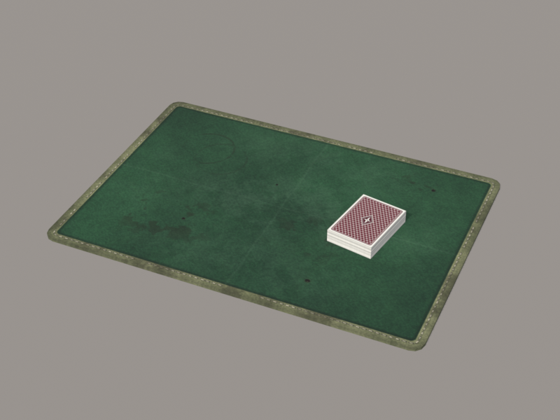
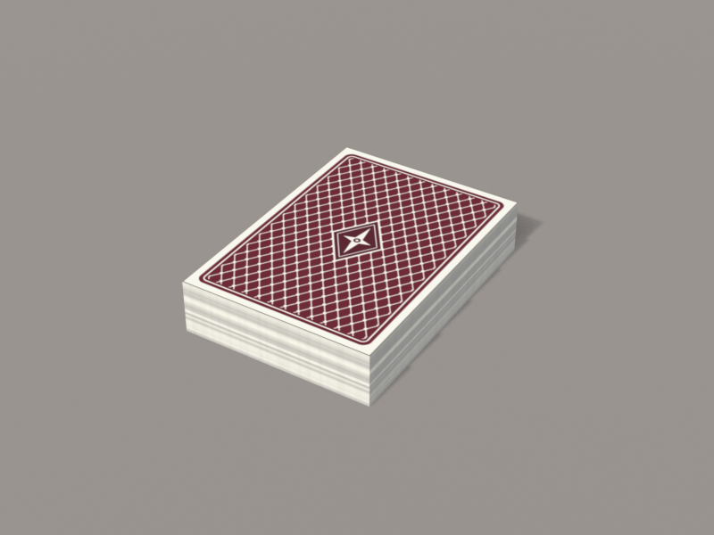
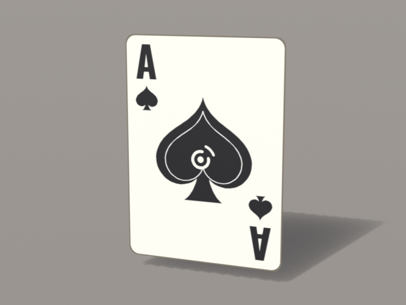
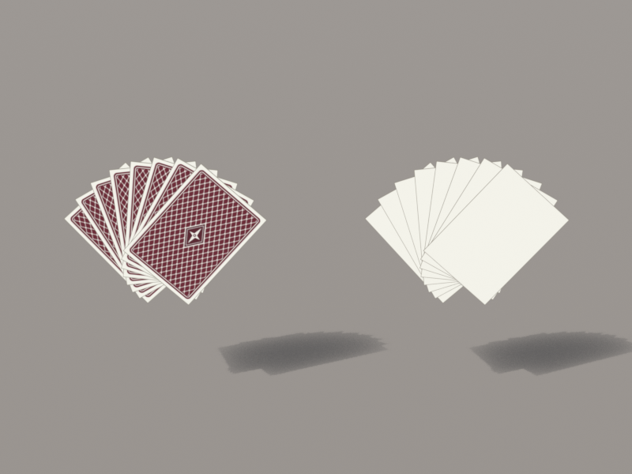
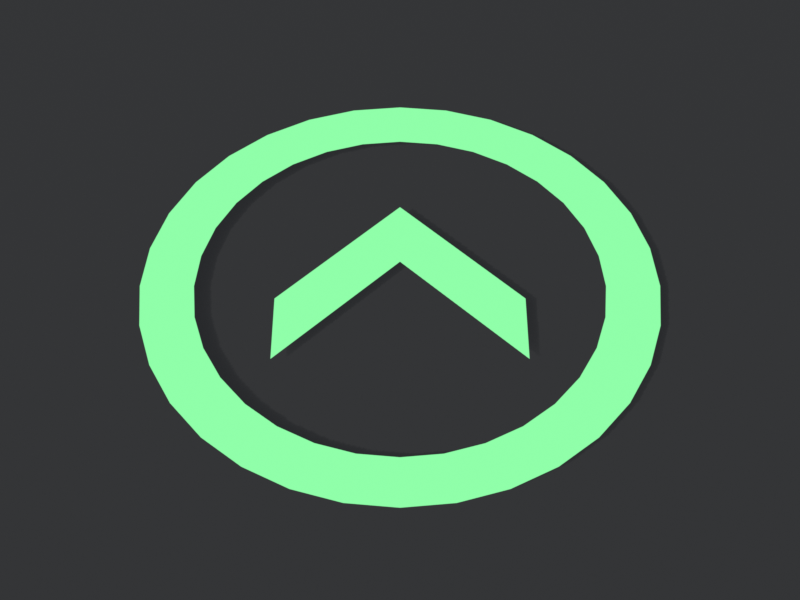
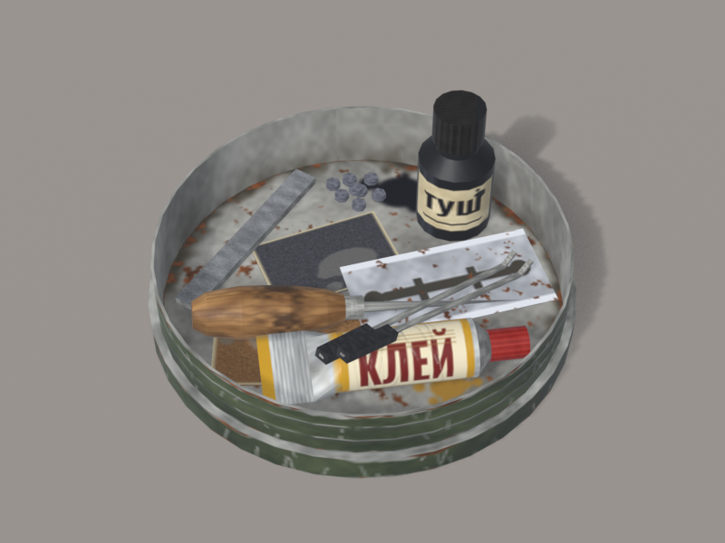

# The models of OpenZone Games

Six small models, drawn from nothing by the scripts in this folder: the laid-out game, the
deck, a single card, the fan of cards in a hand, the mark of a seat and the card sharp's
kit. Nothing in them is copied from another game or mod; meshes and textures alike are made
by the scripts (the pictures some cards of the stalkers' deck carry are GSC Game World's,
see the mod's NOTICE).

| | |
|---|---|
|  |  |
|  |  |
|  |  |

The picture of the fan shows it twice: on the left as others see it, on the right the same
fan turned round, as its holder sees it.

## What is where

| Path | What |
|---|---|
| `OpenZone_Games/models/<model>/` | what the mod ships: the binarized `.p3d`, its `model.cfg` and `data/` (`.paa` textures, `.rvmat` materials) |
| `OpenZone_Games/data/cards/` | the deck sheets and their material, shared by three of the models; `ozg_card.rvmat`, the single card's material |
| `OpenZone_Games/data/cards/<style>/` | the single card's pictures in one deck: `ozg_<style>_<face>_co.paa` for each face and `ozg_<style>_back_co.paa` (`tools/make_cards.py`) |
| `models/src/<model>.py` | the Blender script that builds `models/src/<model>.blend` and renders `models/preview/<model>.png` |
| `models/src/ozg_kit.py` | what the scripts share: faces, LODs, materials, the preview (the name is older than the card sharp's kit and has nothing to do with it) |
| `models/src/make_textures.py` | draws the PNG sources of the textures (Pillow) |
| `models/src/sharpkit_atlas.py` | where each part of the card sharp's kit lies on its one texture: `make_textures.py` draws by it, `sharpkit.py` maps by it |
| `models/<model>/<name>.p3d` | the MLOD exported from the `.blend`: the source the shipped model is built from |
| `models/<model>/data/*.png`, `models/cards/data/*.png` | the texture sources |
| `models/prepare_model_root.py` | lays out the binarize root under `build/model-root` |
| `models/measure.py` | reads the numbers below off the exports and the built models again |

Every path baked into a model or a material starts with `OpenZone_Games\`: moving a folder
means building again, not moving files.

## The models

Sizes are the game's: X to the right, Y up, Z forward, metres. Triangles and sizes were read
off the exported MLODs by `measure.py`.

| Model | Size X x Y x Z | Triangles | Selections | Other LODs |
|---|---|---|---|---|
| `place/ozg_place.p3d` | 0.500 x 0.022 x 0.350 | 70 | `camo`, `deck` | Geometry, View Geometry, Fire Geometry: one box 0.50 x 0.03 x 0.35 |
| `deck/ozg_deck.p3d` | 0.063 x 0.088 x 0.018 | 12 | `camo` | Geometry, View Geometry, Fire Geometry: the same box as the deck; Memory: the inventory's camera |
| `card/ozg_card.p3d` | 0.063 x 0.088 x 0.0003 | 36 | `face`, `back` | Geometry, View Geometry: a box 0.063 x 0.088 x 0.002; Memory: the inventory's camera |
| `hand/ozg_hand.p3d` | 0.149 x 0.112 x 0.0045 | 32 | `card1` ... `card8` | Geometry: one box 0.06 x 0.09 x 0.01 |
| `mark/ozg_mark.p3d` | 0.480 x 0.040 x 0.480 | 68 | `camo` | none |
| `sharpkit/ozg_sharpkit.p3d` | 0.092 x 0.034 x 0.092 | 1212 | `camo` | Geometry and Fire Geometry: one box 0.092 x 0.018 x 0.092, 0.2 kg; View Geometry: the same, 0.034 high; Memory: the inventory's camera |

Each has one visual LOD (resolution 1): at these sizes a second one would save nothing.
Every `model.cfg` has a `CfgModels` class named as its file, no skeleton, no animations,
and the selections above in `sections[]`: a selection that is not a section cannot be
retextured or blanked.

### place: the laid-out game

A cloth mat, 0.50 along X and 0.35 along Z, 4 mm thick, with corners rounded to 15 mm, and
the deck on it: 0.12 m from the middle towards +X, turned 10 degrees clockwise seen from
above, face down. The origin is the middle of the mat's underside and the underside is
Y = 0; the Geometry LOD says `autocenter = 0`, so the engine leaves it there (the built
model carries a bounding centre of 0, 0, 0).

- `camo` is every visible face. The placement hologram repaints hidden selection 0 of the
  class it projects, so that class lists `camo` first.
- `deck` is every face of the deck. It wears the back of the deck the place was laid out
  from.
- The Geometry LOD is one closed box over the whole mat, 3 cm high, 0.4 kg; the View and
  Fire Geometry are the same box, so the cursor's ray meets the thing. A bullet meets the
  game's own `dz\data\data\penetration\cloth.rvmat`.
- The mat's texture is `data/ozg_place_co.paa`, 512 px: dark green felt, rubbed pale where
  hands and cards work, folded in four at some time, stained by a mug and burnt by a
  cigarette, with a lighter binding sewn round the edge. `ozg_place_nohq.paa` raises the
  binding and its stitches, `ozg_place_smdi.paa` (256 px) lets the rubbed felt and the
  stains shine a little. The top face takes the whole picture, +Z at the picture's top.
- `ozg_place_deployable.rvmat` and `ozg_place_undeployable.rvmat` are what the hologram puts
  on: `<hologramMaterialPath>\<hologramMaterial>_deployable.rvmat` where the game may be
  laid out, `..._undeployable.rvmat` where it may not.

### deck: the item

The same stack of cards (`ozg_kit.py`, `Lod.stack`), with an underside: the top and the
underside are both the card back (`back_under`), the four sides the edge band. `camo` is
every face. The Geometry LOD is a box of the same size, 0.1 kg, `autocenter = 0`: the
origin is the middle of the stack (the built model's bounding centre is 0, 0, 0).

The stack STANDS in the model, as the game's own Matchbox stands, whose pose in the hand
the deck borrows (`OZG_Hand.c`, `Matchbox.anm`): 0.063 along X, 0.088 along Y, 0.018 along
Z, the back towards +Z. The matchbox is a box 0.065 x 0.121 x 0.037 with its long side
along Y and its thin side along Z (read off `dz\gear\consumables\Matchbox.p3d`). `TURN` at
the top of `deck.py` (yaw, tilt, lean, in degrees) says how the stack drawn lying is stood.

Measured in the game on 2026-11-24:

- `rotationFlags = 16` in the config lays the item on the ground with its Z axis upright
  and +Z on top. The deck lying in its model stood on its end; standing with its back
  towards -Z it lay face up; with the back towards +Z it lies back up. `rotationFlags = 32`
  left it standing on its end.
- In the hand the Matchbox pose turns the model's -Z towards the thigh, so whatever the
  underside is shows there. That is why it is the back as well and not the sheet's blank
  face: no side of the item shows a white block.
- The picture in the inventory (the slot, the hands, the tooltip) is taken from the
  Memory LOD's `invView` point, framed by `boundingbox_min` and `boundingbox_max`; without
  them the camera looked along Z at the deck's edge. `invView` is 0.24 in front of the
  back, a little aside and above, so the back and two sides show.

### card: one card

One card as a thing: a card of 0.063 x 0.088 with corners rounded to 3.5 mm, two faces
0.3 mm apart. It STANDS in the model, the face towards -Z, the back towards +Z, as the
game's own PunchedCard stands (its printed side towards -Z, where its inventory camera
is). `face` and `back` are the two selections, each one side, and each side takes a whole
texture stretched over the card (256 x 512): every card of every deck is this one model,
and what tells them apart is the pictures. The config names the classic deck's; the
script puts on those of the card's own look (`OZG_Card_Base.OZG_Paint`). The material is
`OpenZone_Games/data/cards/ozg_card.rvmat`, the deck's matte paper with flat 16 px
`ozg_card_nohq.paa` and `ozg_card_smdi.paa`.

The Geometry and View Geometry LODs are a box 0.063 x 0.088 x 0.002, 0.002 kg,
`autocenter = 0`: the origin is the middle of the card, and the PunchedCard pose
(`OZG_Hand.c`) holds a card so made by its end, the face outwards (seen in the game,
2026-11-24). `rotationFlags = 16` lays it back up; `invView` is 0.30 in front of the face,
so the inventory shows the face.

The pictures of a card are `OpenZone_Games/data/cards/<style>/ozg_<style>_<face>_co.paa`
and `ozg_<style>_back_co.paa`, and the style is in the file's NAME on purpose. Measured
2026-11-24: with the two decks' pictures named alike in two folders (`classic\c_2s_co.paa`,
`stalker\c_2s_co.paa`), both decks in one inventory drew the same picture for each card,
the classic one for some cards and the stalkers' for others, while the script set the
right path for every card on both sides (checked by printing it). Named apart, each deck
draws its own.

### hand: the fan

Eight cards, each two faces 0.3 mm apart: the back and the blank face. They share a pivot
12 mm up from a card's bottom edge on its middle line, are fanned in steps of 12 degrees
(84 from the first to the last), and each lies 0.6 mm nearer the holder than its left
neighbour, so that every card's left strip shows to the holder, as in a fan that is held.

As the model ships: the pivot is the origin, the cards rise towards +Y, the fan spreads
along X, the backs look towards +Z and the faces towards -Z. `card1` is the card at -X (the
holder's leftmost, the one lying nearest to +Z) and `card8` the card at +X. A selection is
both sides of one card. A hand of fewer than eight looks best with cards from the middle:
`card4` and `card5` for two.

Three lines at the top of `hand.py` say how the fan stands in the model, and so in the
hand: `BACKS` (`"+Z"` or `"-Z"`: the fan turned half round the vertical axis, so the
holder's left stays the holder's left), `TURN` (yaw, tilt, lean, in degrees) and `SHIFT`
(metres: the pivot leaves the origin). The Geometry LOD goes with them: a box the size of
one card standing at the pivot, 0.05 kg, `autocenter = 0`. There is no View or Fire
Geometry.

The game's own Paper, whose pose in the hand a fan may borrow, stands the same way as the
fan: a sheet 0.22 wide along X and 0.29 high along Y, thin along Z (read off
`dz\gear\consumables\Paper.p3d`). Its MIDDLE is at the origin, so in that pose the fan's
pivot is where the middle of the sheet would be: `SHIFT` is for that.

### mark: the mark of a seat

A flat ring, 0.24 m outside and 0.19 m inside, 32 sides, with an arrow head in it that
points towards +Z. Both lie 0.02 m above Y = 0 and look up only; the origin is on the floor
in the middle of the ring. `camo` is every face. The mark casts no shadow
(`lodnoshadow = 1`, and every face says so too).

Its colour is in two places. What the light of day shows is a procedural texture in the
model, `#(argb,8,8,3)color(0.25,0.9,0.35,1.0,co)`, which the config changes through
`hiddenSelectionsTextures`. What glows is the material: `data/ozg_mark.rvmat` has
`emmisive[] = {0.05,1.0,0.15,10}`, a green, and the fourth number is the strength (the
game's own brake lights have 8 to 12). The glow is given a colour of its own because that
is what the game's materials do: of its 28 Super materials that glow with a strength of 2
or more and have no emissive texture stage, 27 colour `emmisive[]` itself. So a mark of
another colour takes two lines in the config, the texture and the material;
`ozg_mark_amber.rvmat` is the same material glowing amber.

A material is baked into the model when the model is built. After a change to
`ozg_mark.rvmat` build the model again, or name the material in
`hiddenSelectionsMaterials[]`: that reads the file when the game runs.

`ozg_mark_nohq.paa` and `ozg_mark_smdi.paa` are flat, 16 px: a glowing ring has no relief
and no shine. They are files and not procedural colours so that the material has the same
stages as the others, which is also what `asset_check` counts (C4).

**It has no Geometry, no View Geometry and no Fire Geometry**: nothing stops a body, and
the cursor's ray finds nothing. That leaves the origin to look after. A model's origin is
moved to the middle of the box round it unless its Geometry LOD says `autocenter = 0`, and
binarize does not read that property from a visual LOD (measured: with it and without it
the built model carried the same bounding centre, 0.02 up, which lays the ring ON the
floor). So the model carries one point with no face on it, 0.02 m UNDER the floor: the box
is then as deep as it is high, its middle is the origin, and the built model's bounding
centre is 0, 0, 0 (measured). That point is why the model is 0.04 m high in the table.
`KEEP_ORIGIN = "box"` in `mark.py` is the other way: a real Geometry LOD, a 1 cm box on the
floor in the middle of the ring.

### sharpkit: the card sharp's kit

An open tin standing in its own lid -- the tin 88 mm across and 18 mm high, the lid 91.6 mm
-- and the handmade things a card sharp keeps in it: a squat bottle of Indian ink with ТУШ
on its label, a tube of glue with КЛЕЙ on it, an awl with a wooden handle, a cut-down file,
two scraps of sandpaper (a coarse brown one under the awl's handle, a fine black one on the
floor), a razor blade, a little heap of lead pips for loading dice and two picks bent out of
wire, their handles bound with tape. Everything takes one texture of 512 px, its parts laid
out by `src/sharpkit_atlas.py`; the two words on the labels are Ukrainian, drawn in Oswald
(`art/fonts/oswald`).

It STANDS in the model as it stands on a table: open side towards +Y, the middle of the
lid's underside at the origin (`autocenter = 0`; the built model's bounding centre is
0, 0, 0). What lies in it is laid out for somebody in front of it, at +Z and above, where
the inventory's camera is (`invView` 0.02, 0.17, 0.15), and the ink bottle's label is turned
towards that point. `camo` is every face.

Measured in the game on 2026-11-25 (diag 1.30, the NHChernobyl stand):

- `rotationFlags = 32`, the TunaCan's, laid it on the ground upside down; `0` lays it open
  side up, as the game's own Pot lies, whose config names none.
- In the hand it borrows the TunaCan's pose (`OZG_Hand.c`, `tuna.anm`), which holds it by
  the rim with the open side turned outwards. That is how the game holds its own open tins:
  TunaCan_Opened takes the same pose, and Pate_Opened's `foodcan100g.anm` turns its opening
  outwards as well.
- The inventory, the hands slot and the item's own window show the open tin from in front
  and above, both labels readable.

The material, `data/ozg_sharpkit.rvmat`, is the place's with the shine of the game's sewing
kit (specular 0.54, power 100, fresnel 2, 0.81). `ozg_sharpkit_smdi.paa` says where it
shines: glass, the blade and bare steel most, the enamel less, paper, wood and sand hardly.

## The deck sheet

`OpenZone_Games/data/cards/ozg_deck_<style>_co.paa`, 512 x 512, opaque, drawn by
`tools/make_cards.py` (its PNG is `art/cards/<style>/deck_sheet.png`). Origin at the top
left:

| Field | Pixels | On the models |
|---|---|---|
| the card back, stretched to fill | x 0..255, y 0..511 | the top of the deck, the underside of the deck item, the back of every card of the fan |
| a blank card face | x 256..511, y 0..383 | the face of every card of the fan |
| the edge band | x 256..511, y 384..511 | the four sides of the deck |

The models take each field one texel inside its border. In a model the texture is the
classic deck's sheet; the config puts the sheet of the deck's own style on through the
hidden selections.

The material is `ozg_deck.rvmat`, matte paper, and it belongs to the models:
`ozg_deck_nohq.paa` is flat but for the edge band, where the cards lie on each other as
soft ridges, and `ozg_deck_smdi.paa` gives the back a soft sheen, the face less and the
side of the stack none.

## In config.cpp

```
// the deck
model = "\OpenZone_Games\models\deck\ozg_deck.p3d";
rotationFlags = 16;
hiddenSelections[] = {"camo"};
hiddenSelectionsTextures[] = {"OpenZone_Games\data\cards\ozg_deck_classic_co.paa"};
hiddenSelectionsMaterials[] = {"OpenZone_Games\data\cards\ozg_deck.rvmat"};

// a card (tools/make_card_items.py writes the fifty-two classes)
model = "\OpenZone_Games\models\card\ozg_card.p3d";
rotationFlags = 16;
hiddenSelections[] = {"face", "back"};
hiddenSelectionsTextures[] = {"OpenZone_Games\data\cards\classic\ozg_classic_As_co.paa", "OpenZone_Games\data\cards\classic\ozg_classic_back_co.paa"};
hiddenSelectionsMaterials[] = {"OpenZone_Games\data\cards\ozg_card.rvmat", "OpenZone_Games\data\cards\ozg_card.rvmat"};

// the place
model = "\OpenZone_Games\models\place\ozg_place.p3d";
hiddenSelections[] = {"deck"};
hiddenSelectionsTextures[] = {"OpenZone_Games\data\cards\ozg_deck_classic_co.paa"};
hiddenSelectionsMaterials[] = {"OpenZone_Games\data\cards\ozg_deck.rvmat"};

// what the hologram shows: camo is selection 0, and no texture is named for it
model = "\OpenZone_Games\models\place\ozg_place.p3d";
hiddenSelections[] = {"camo"};
hologramMaterial = "ozg_place";
hologramMaterialPath = "OpenZone_Games\models\place\data";

// the fan
model = "\OpenZone_Games\models\hand\ozg_hand.p3d";
hiddenSelections[] = {"card1", "card2", "card3", "card4", "card5", "card6", "card7", "card8"};
// hiddenSelectionsTextures[]: the sheet, eight times; hiddenSelectionsMaterials[]: ozg_deck.rvmat, eight times

// the mark
model = "\OpenZone_Games\models\mark\ozg_mark.p3d";
hiddenSelections[] = {"camo"};
hiddenSelectionsTextures[] = {"#(argb,8,8,3)color(0.25,0.9,0.35,1.0,co)"};
hiddenSelectionsMaterials[] = {"OpenZone_Games\models\mark\data\ozg_mark.rvmat"};

// a mark of another colour: both lines
hiddenSelectionsTextures[] = {"#(argb,8,8,3)color(1.0,0.72,0.15,1.0,co)"};
hiddenSelectionsMaterials[] = {"OpenZone_Games\models\mark\data\ozg_mark_amber.rvmat"};

// the card sharp's kit
model = "\OpenZone_Games\models\sharpkit\ozg_sharpkit.p3d";
rotationFlags = 0;
hiddenSelections[] = {"camo"};
hiddenSelectionsTextures[] = {"OpenZone_Games\models\sharpkit\data\ozg_sharpkit_co.paa"};
hiddenSelectionsMaterials[] = {"OpenZone_Games\models\sharpkit\data\ozg_sharpkit.rvmat"};
```

`camo` and `deck` overlap on the place: the deck's faces are in both, and a texture put on
`camo` goes onto the deck as well. So the class the hologram shows names no texture for
`camo` and inherits none; and if one class ever lists both selections, `camo` has to come
first with the mat's texture, and the deck's sheet after it.

## Building

The texture sources, when a picture changes:

```
python -I models/src/make_textures.py [place] [deck] [mark] [card] [sharpkit]
asset_convert(source="models/place/data/ozg_place_co.png",
              output="../../../OpenZone_Games/models/place/data/ozg_place_co.paa")
```

(with no name it draws them all) and so for each PNG (`output` is read from the source's
own folder): `models/place/data/*`, `models/mark/data/*` and `models/sharpkit/data/*` go to
the model's own `data/`, `models/cards/data/*` to
`OpenZone_Games/data/cards/`. ImageToPAA picks the format by the source's name (`_co` DXT1,
`_nohq` DXT5 with the swizzle, `_smdi` DXT1). The `.rvmat` files are kept by hand.

A model, when its script changes (one Blender at a time, four threads):

```
blender -b -t 4 --python models/src/<model>.py
python models/prepare_model_root.py
asset_export(blend="models/src/<model>.blend", mod="OpenZone_Games",
             source="models/<model>", name="ozg_<model>.p3d")
python models/prepare_model_root.py --collect
asset_build(mod="OpenZone_Games", source="models/<model>")
asset_check(mod="OpenZone_Games")
```

The script builds the `.blend` from nothing and renders the preview (`-- --no-preview`
after the script's name skips the picture). It needs the Arma 3 Object Builder add-on
enabled in Blender: the add-on's properties are what makes an object a LOD, and its
exporter is what `asset_export` runs. `prepare_model_root.py` stages the sources under
`build/model-root` (`dayz-mcp.toml`, `[build] project_root`) with links to the mod's `data\`
folders and to the vanilla `dz\data\data\penetration\`; it needs the unpacked vanilla `dz`
(`OZ_VANILLA_DZ`, or one of the usual places). `--collect` copies a fresh export back to
`models/<model>/`, where it is committed. `asset_build` runs binarize from that root, judges
what came out and copies it into the mod.

Without Blender, `python models/prepare_model_root.py` and then `asset_build` and
`asset_check` build the shipped models from the committed MLODs.

## Checked, and not

Read off the files (2026-11-24):

- the sizes, triangles, selections, masses and named properties in the table, off the
  MLODs (`measure.py`);
- a game point (X, Y, Z) is the Blender point (X, Z, Y) in the exporter, and the corner
  order and the stored normals of the exports agree with those of a model of the series
  that is known to work in the game;
- the built models: all five are clean for `asset_check` (C1 to C12), both materials of
  the place were inlined, the selections are in the models, and `sections[]` does split
  the faces (the fan built with an empty `sections[]` is 326 bytes smaller);
- the bounding centre each built model carries (`measure.py`): 0, 0, 0 for all five.
- the card sharp's kit (2026-11-25) likewise: clean for `asset_check`, its bounding
  centre 0, 0, 0; what the game showed of it is under its own heading.

Seen in the game (2026-11-24, diag 1.30, the NHChernobyl stand): the deck and the card in
the inventory, in the hand and on the ground, as written under each; both decks' cards in
one inventory, each with its own pictures; the classic back with the mark of the series
in the window and on the 3D things.

Not checked, because only the game can say:

- how the fan sits in a hand: which way it faces and where the fingers are in each pose
  (`BACKS`, `TURN`, `SHIFT`);
- how bright the mark is by day and by night (the fourth number of `emmisive[]`), and
  that its glow keeps the material's colour whatever the texture is;
- the mark as an item with no geometry at all: that nothing meets it, and that it stands
  where it is put;
- the hologram's two materials on the place;
- that a blanked card is gone and the others stay.

## Author and licence

Made for this mod by the scripts in this folder; the deck sheets by `tools/make_cards.py`.
The licence is the series': CC BY-NC-SA 4.0 with the additional permission in
[NOTICE](../NOTICE).
